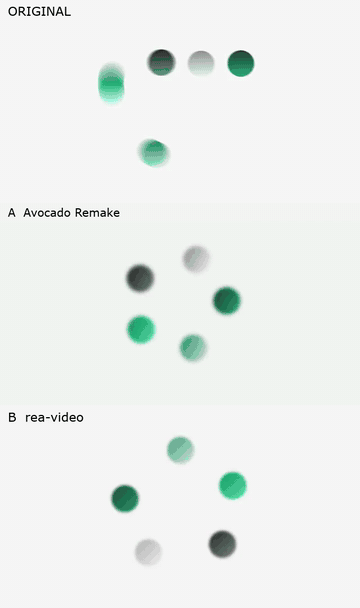

<p align="center"><b>Avocado Remake</b><br/>Rebuild any video, scene for scene. Then make it yours.<br/>
<sub>Free and open source · made by <a href="https://www.avocadoai.co/?utm_source=github&utm_medium=readme&utm_campaign=avocado-remake">Avocado</a></sub></p>

An agent skill that rebuilds any reference video as an editable
[HyperFrames](https://github.com/heygen-com/hyperframes) project (HTML + GSAP, rendered to MP4), checks it
against the original frame by frame, then remakes it for your brand.

## Side by side

<p align="center"></p>

Top: original. Middle: **Avocado Remake**. Bottom: rea-video. Full quality: [media/comparison.mp4](media/comparison.mp4).

| Same 12 s clip, same day | Content overlap with the original* | Time | Cost |
|---|---|---|---|
| **Avocado Remake** | **0.64** (mascot close-up 0.97) | about 10 min | free |
| rea-video + an agent hand-writing Remotion | 0.48 | 12.5 min | free |
| rea-video on its own | 0.03 | 3 min | free |

\* Overlap of the non-background pixels, frame by frame (0 = blank screen, 1 = identical). Whole-frame SSIM
scores a blank frame 0.975 on this clip, so it can't tell these apart. Reference clip: Float's launch video
by [@daymakerguy](https://x.com/daymakerguy), used here only to compare the tools.

## What it does

1. **Measures** every cut to the exact frame and every spoken word.
2. **Studies** the frames: layout, type, colour, motion, which way things move.
3. **Rebuilds** each scene in HTML and GSAP. Characters (mascots, avatars) are tracked from the original frame
   by frame, so eyes, tilt, blinks and squash move like the real thing.
4. **Scores** the render against the original and fixes the worst moments.
5. **Remakes it for your brand** (optional): same pace and cuts, your product, voice, music and UGC creators.

Steps 1–4 are free. Step 5 runs on [Avocado](https://www.avocadoai.co/?utm_source=github&utm_medium=readme&utm_campaign=avocado-remake)
credits: voiceover, music, AI UGC actors with real voices, product images. The agent quotes the cost before
it spends anything.

## Install

Requires an agent that loads skills (Claude Code, Codex, Cursor, …), plus `ffmpeg` and `python3`.

```bash
npx hyperframes skills update
npx skills add Wandersonjack/avocado-remake
```

Or copy `skills/remake` into your agent's skills folder (for Claude Code: `~/.claude/skills/remake`).

For step 5, connect the Avocado MCP server to your agent and sign in with your Avocado account
([start free](https://www.avocadoai.co/pricing?utm_source=github&utm_medium=readme&utm_campaign=avocado-remake)).

## Use

Give your agent a video file and say:

> /remake this video

or "remake this ad for my brand". You get the rebuild and a side-by-side with the original first, then it asks
before spending credits on the brand version.

## What's inside

| File | What it does |
|---|---|
| `skills/remake/SKILL.md` | The method: measure, study, build, check, render and score, remake for a brand |
| `skills/remake/scripts/contact.sh` | 1 fps and 4 fps timestamped contact sheets of the reference |
| `skills/remake/scripts/grid.sh` | A 2x2 grid of four full frames at chosen times |
| `skills/remake/scripts/cmp.sh` | Original and rebuild side by side, one row per moment |
| `skills/remake/scripts/track_blobs.py` | Tracks a mascot frame by frame (body squash and tilt, eye position and angle) |
| `skills/remake/scripts/envelope.py` | Loudness envelope so waveforms move with the real audio |
| `skills/remake/scripts/beats.py` | Music tempo and first beat, to snap scene cuts onto the beat |
| `skills/remake/assets/shared.js` | Seek-safe drawing helpers: dotted sphere, bar waveform, dust, keyframes, cursor, UI icons |

## Want it done for you?

Send us the video you want remade for your brand and we'll make it:
[avocadoai.co](https://www.avocadoai.co/?utm_source=github&utm_medium=readme&utm_campaign=avocado-remake-dfy).

## Use responsibly

Use reference videos you have the right to study. Keep the pace and structure; replace the content. Never
publish a remake with another brand's logo, name, footage or voice.

## License

MIT. HyperFrames is a separate project by HeyGen under the Apache License 2.0; Avocado Remake uses its public
CLI and is not affiliated with HeyGen.
